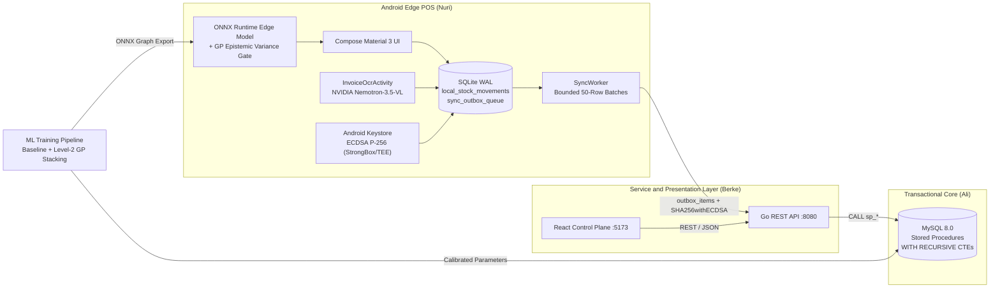
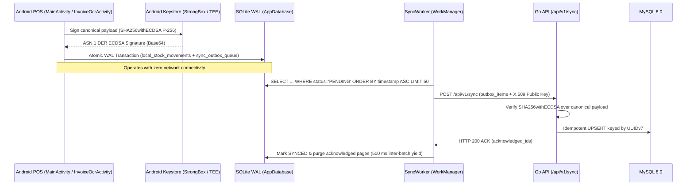

# BAN Food Intelligence — AVATAR Enterprise Resource Planning and Edge AI System

**Technical Architecture and Assessment Specification for the Delta-A AVATAR Artificial Intelligence Competition**


---

## Abstract

BAN Food Intelligence is an enterprise-grade food manufacturing, livestock cost accounting, recursive lot traceability, emergency recall orchestration, and multi-tier machine learning platform developed for the Delta-A AVATAR Artificial Intelligence Competition. The architecture integrates a relational transactional core in MySQL 8.0, a stateless Go REST service layer, a React administrative control plane, an offline-first Android Point-of-Sale (POS) terminal written in Kotlin with Jetpack Compose, and a physics-informed ensemble machine learning engine exported to ONNX for deterministic edge execution.

---

## Table of Contents

1. [System Overview](#1-system-overview)
2. [Deployment and Quick Start](#2-deployment-and-quick-start)
3. [System Architecture and Engineering Separation](#3-system-architecture-and-engineering-separation)
4. [Technical Assessment Analysis](#4-technical-assessment-analysis)
   - [4.1 Task 1: Subcontracted Production Cost Accounting](#41-task-1-subcontracted-production-cost-accounting)
   - [4.2 Task 2: Carcass Disassembly Reconciliation and Cost Discrepancy Analysis](#42-task-2-carcass-disassembly-reconciliation-and-cost-discrepancy-analysis)
   - [4.3 Task 3: Recursive Lot Genealogy and Recall Quarantine](#43-task-3-recursive-lot-genealogy-and-recall-quarantine)
   - [4.4 Task 4: Physics-Informed Machine Learning and Level-2 Gaussian Process Stacking](#44-task-4-physics-informed-machine-learning-and-level-2-gaussian-process-stacking)
   - [4.5 Task 5: Multimodal Invoice Optical Character Recognition via NVIDIA NIM](#45-task-5-multimodal-invoice-optical-character-recognition-via-nvidia-nim)
   - [4.6 Offline-First Synchronization Protocol: UUIDv7 and Hardware ECDSA P-256](#46-offline-first-synchronization-protocol-uuidv7-and-hardware-ecdsa-p-256)
5. [Repository Structure](#5-repository-structure)
6. [Verification and Test Suite](#6-verification-and-test-suite)

---

## 1. System Overview

| Subsystem | Technical Scope |
|---|---|
| **Transactional Core (`database-mysql`)** | Relational schema in MySQL 8.0 enforcing lot-level inventory invariants, multi-input production orders, carcass disassembly yields, and customer dispatch ledgers. Implements stored procedures for unit cost computation (`sp_calculate_production_cost`), disassembly execution (`sp_execute_butchery`), and recall cascade (`sp_recall_by_lot`), alongside `WITH RECURSIVE` Common Table Expressions (CTEs) for bidirectional genealogy traversal. |
| **Application Service Layer (`api-go`)** | Stateless HTTP REST service implemented in Go 1.22. Mediates all database transactions via connection-pooled prepared statements and stored procedure invocations, exposes telemetry endpoints to the web client, and validates cryptographic signatures (`SHA256withECDSA`) on incoming edge synchronization batches. |
| **Administrative Control Plane (`web-react`)** | Single-page React 18 application providing real-time visibility into external production unit cost (EKP), lamb butchery cost allocation under physical-quantity and net-realizable-value (NRV) methodologies, multi-tier recall impact analysis, interactive lot genealogy graphs, and machine learning deviation tables. |
| **Offline-First Edge Terminal (`mobile-kotlin`)** | Android POS and warehouse receiving application built with Kotlin and Material Design 3. Persists local stock movements in a Write-Ahead Logging (WAL) SQLite database, signs outbox mutations with hardware-backed ECDSA P-256 keys resident in Android StrongBox/TEE, enforces immediate Kiosk lockdown (`startLockTask()`) upon recalled lot detection, and integrates multimodal invoice OCR via NVIDIA NIM (`nvidia/nemotron-3.5-super-vl-120b-a12b`). |
| **Predictive Intelligence Engine (`ml-engine`)** | Python modeling suite implementing physics-informed regression, simplex-constrained carcass yield estimation, Level-2 Gaussian Process (GP) uncertainty stacking with adversarial Fast Gradient Sign Method (FGSM) hardening, and multi-output ONNX compilation (`nuri_consortium_edge.onnx`). |

---

## 2. Deployment and Quick Start

### Prerequisites
- Docker Engine 24.0+ and Docker Compose v2.
- Available host TCP ports: `3306` (MySQL 8.0), `8080` (Go REST API), and `5173` / `3000` (React Control Plane).

### Single-Command Initialization

```bash
git clone https://github.com/meowmet/ban-food-intelligence.git
cd ban-food-intelligence
docker compose up -d --build
```

Docker Compose enforces deterministic startup ordering via container health probes:
1. `mysql` initializes the `food_intel` database and executes `01_schema.sql` and `02_seed.sql` on first boot.
2. `api-go` awaits a healthy `mysqladmin ping` state before opening its connection pool and binding to port `8080`.
3. `web-react` compiles the production bundle and serves the administrative interface on ports `5173` and `3000`.

| Service | Endpoint | Credentials / Notes |
|---|---|---|
| **React Administrative Dashboard** | `http://localhost:5173` (or `http://localhost:3000`) | Primary evaluation interface for Tasks 1 through 4 |
| **Go REST API** | `http://localhost:8080/health` | Returns HTTP 200 with MySQL connection telemetry |
| **MySQL 8.0 Engine** | `localhost:3306` | User: `root` / Password: `ban` / Schema: `food_intel` |

### Operational Commands

```bash
# Inspect Go API service logs
docker compose logs -f api-go

# Execute forward lot genealogy traversal directly inside MySQL
docker compose exec mysql mysql -uroot -pban food_intel -e "CALL sp_trace_forward('ET-2026-001')"

# Reset database state and re-import canonical seed data
docker compose down -v
```

### REST API Contract

| HTTP Method | Route | Functional Description |
|---|---|---|
| `GET` | `/health` | Service liveness and MySQL connection pool verification |
| `GET` | `/production?order_no=URT-2026-045` | Task 1 subcontracted production cost breakdown and unit EKP |
| `GET` | `/butchery` | Task 2 lamb carcass disassembly reconciliation and cost allocation |
| `GET` / `POST` | `/recall` | Task 3 forward contamination trace and affected customer ledger |
| `GET` | `/trace/{lot}?direction=forward\|backward` | Bidirectional `WITH RECURSIVE` lot genealogy |
| `GET` | `/yield` | Task 4A and Task 4B predicted versus actual yield and EKP comparison |
| `POST` | `/api/v1/sync` | Hardware-signed ECDSA P-256 POS outbox batch ingestion |
| `POST` | `/sync/register-key` | X.509 SubjectPublicKeyInfo (SPKI) enrollment for POS terminals |

### Android Edge POS Compilation

```bash
cd mobile-kotlin
./gradlew installDebug        # On Windows PowerShell: .\gradlew.bat installDebug
```

---

## 3. System Architecture and Engineering Separation



### Architectural Responsibility Matrix

| Engineer | Domain | Primary Deliverables |
|---|---|---|
| **Ali** — Data Engineering and Baseline Modeling | Relational schema design, transactional stored procedures, recursive graph queries, synthetic data contracts, and baseline gradient boosting | `database-mysql/schema.sql`, `database-mysql/seed.sql`, `ml-engine/ml_contract.py`, `ml-engine/train_model_ali.py`, `ml-engine/anomaly_ali.py` |
| **Nuri** — Edge Computing, Cryptography, and Ensemble AI | Offline-first Android POS, SQLite WAL outbox, StrongBox/TEE ECDSA P-256 signing, Kiosk recall lockdown, NVIDIA VL invoice OCR, physics-informed stacking, and ONNX compilation | `mobile-kotlin/`, `ml-engine/train_model_nuri.py`, `ml-engine/nuri_consortium_pipeline.py`, `ml-engine/stacking_meta_learner.py` |
| **Berke** — Backend Services and Web Visualization | Go HTTP server, MySQL connection pooling, ECDSA signature verification endpoint, cost allocation reconciliation, and React administrative dashboard | `api-go/`, `web-react/` |

Strict separation of concerns guarantees that ERP state transitions occur exclusively through auditable database procedures, external clients interact solely with the stateless Go API, and edge terminals communicate only via cryptographically signed, idempotent outbox payloads.

---

## 4. Technical Assessment Analysis

### 4.1 Task 1: Subcontracted Production Cost Accounting

For production order **`URT-2026-045`** (subcontracted processing of raw meat lot `ET-2026-001` into packaged sausage lot `SUC-2026-045`), the system aggregates raw material consumption, spice and casing inputs, and external processing fees:

$$\text{Total Production Cost} = 1,543.50\ \text{EUR}, \qquad \text{Actual Output} = 85\ \text{packages}$$

$$\text{Unit Cost (EKP)} = \frac{1,543.50\ \text{EUR}}{85\ \text{packages}} = 18.1588\ \text{EUR} \approx 18.16\ \text{EUR / package}$$

---

### 4.2 Task 2: Carcass Disassembly Reconciliation and Cost Discrepancy Analysis

In the lamb butchery scenario (carcass lot **`KUZ-2026-001`**), the specification states a purchase quantity of **25.00 kg** at a unit price of **11.50 EUR/kg**, while simultaneously reporting a total raw material cost of **351.00 EUR**.

#### Mathematical Formulation of the Anomaly

$$\text{Calculated Purchase Cost} = 25.00\ \text{kg} \times 11.50\ \text{EUR/kg} = 287.50\ \text{EUR}$$

$$\text{Reported Total Cost} = 351.00\ \text{EUR}$$

$$\Delta_{\text{cost}} = 351.00\ \text{EUR} - 287.50\ \text{EUR} = +63.50\ \text{EUR}\ (+22.09\%)$$

| Reconciliation Dimension | Computed Value | Assessment Status |
|---|---|---|
| **Physical Mass Balance** | $8.0\ \text{kg (Leg)} + 4.5\ \text{kg (Loin/Back)} + 5.0\ \text{kg (Shoulder)} + 4.5\ \text{kg (Mince)} = 22.0\ \text{kg net yield}$ | Exact conservation when combined with $3.0\ \text{kg bone/waste} = 25.0\ \text{kg}$ |
| **Direct Merchandise Cost** | $25.0\ \text{kg} \times 11.50\ \text{EUR/kg} = 287.50\ \text{EUR}$ | Baseline invoice merchandise value |
| **Reported Ledger Cost** | $351.00\ \text{EUR}$ (implies effective input rate of $14.04\ \text{EUR/kg}$) | Contains $+63.50\ \text{EUR}$ unitemized variance |

#### Accounting Interpretation and System Handling
1. **Conservation of Mass vs. Valuation Variance:** Because the physical outputs ($22.00\ \text{kg}$ saleable cuts plus $3.00\ \text{kg}$ bone and trim loss) equal the $25.00\ \text{kg}$ input carcass exactly, the discrepancy is strictly a **financial valuation variance** rather than an unrecorded physical weight loss.
2. **Root Cause Classification:** In industrial meat accounting, a $+63.50\ \text{EUR}$ difference between merchandise price and capitalized lot cost arises either from **ancillary landed costs** (slaughterhouse service fee, veterinary inspection, cold-chain freight, or cutting labor capitalized into the batch) or from an **upstream invoice/unit-price data entry error** ($14.04\ \text{EUR/kg}$ actual vs. $11.50\ \text{EUR/kg}$ recorded).
3. **Dual-Basis Allocation Engine:** Rather than silently discarding one figure, the Go reconciliation controller (`/butchery`) and React [`ButcheryCostTable.jsx`](file:///c:/Users/meowm/Desktop/some%20projects/avatar%20delta%20ai/web-react/src/components/ButcheryCostTable.jsx) surface both figures side by side and compute unit costs under two standard accounting methods across the $22.00\ \text{kg}$ saleable yield (absorbing the $3.00\ \text{kg}$ waste into saleable cuts):
   - **Physical Weight Allocation:** Distributes total cost uniformly per kilogram of saleable output ($287.50 / 22 = 13.07\ \text{EUR/kg}$ calculated; $351.00 / 22 = 15.95\ \text{EUR/kg}$ reported).
   - **Net Realizable Value (NRV / Market-Value) Allocation:** Weights cost absorption proportionally to each cut's commercial selling price so high-value cuts (Loin/Back, Leg) absorb a higher share of input cost than trim/mince.

---

### 4.3 Task 3: Recursive Lot Genealogy and Recall Quarantine

When raw meat lot **`ET-2026-001`** is flagged for contamination, the stored procedure `sp_recall_by_lot` and recursive CTE queries traverse the directed acyclic production graph forward:

$$\texttt{ET-2026-001 (Raw Meat)} \longrightarrow \texttt{URT-2026-045 (Production Order)} \longrightarrow \texttt{SUC-2026-045 (85 Packages)}$$

The system identifies all **85 affected packages** across downstream retail customers (**Market A: 30 packages**, **Market B: 25 packages** including Tier-2 sub-distribution, and **Market C: 30 packages**) with complete contact records. On the Android POS terminal, any attempt to execute a `SALE` against lot `SUC-2026-045` is intercepted pre-commit, aborting the SQLite transaction and engaging [`RedRecallLockActivity`](file:///c:/Users/meowm/Desktop/some%20projects/avatar%20delta%20ai/mobile-kotlin/src/main/kotlin/com/ban/foodintelligence/pos/ui/RedRecallLockActivity.kt) in hardware-pinned Kiosk mode.

---

### 4.4 Task 4: Physics-Informed Machine Learning and Level-2 Gaussian Process Stacking

#### Architectural Progression Over Simple Baselines
Naive baselines rely on static recipe nominal ratios (`baseline_recipe`) or unconditional historical averages (`baseline_hist_mean`), ignoring carcass-specific covariates (fat-to-lean ratio, chill duration, supplier variability, and ambient humidity). Our modeling pipeline improves upon these baselines through four mechanisms:

1. **Thermodynamic and Mass-Balance Feature Engineering:** Incorporates domain interaction terms and enforces physical conservation laws so predicted outputs cannot violate input mass constraints.
2. **Simplex-Constrained Multi-Output Projection (Task 4B):** Carcass cut percentages ($\text{leg}, \text{loin}, \text{shoulder}, \text{rib}, \text{mince}, \text{waste}$) are projected onto the canonical probability simplex ($\sum_k \hat{p}_k = 100\%$, $\hat{p}_k \ge 0$), guaranteeing that predicted cut weights sum identically to the input carcass weight to floating-point precision ($1.42 \times 10^{-14}\ \text{kg}$ maximum deviation).
3. **Level-1 Heterogeneous Base Learners + Level-2 Gaussian Process Meta-Learner:** Out-of-fold predictions from Physics-Informed Ridge (`nuri_pinn_ridge`), Huber Regressor (`nuri_huber`), and LightGBM (`nuri_lgbm`) — augmented in the retail edge pipeline (`nuri_consortium_pipeline.py`) by a Physics-Informed TabNet (PINN-TabNet) architecture, XGBoost, CatBoost, and Extra Trees — feed a Level-2 Gaussian Process Regressor (`RBF + Matern + WhiteKernel`). Unlike point-estimate linear blenders, the Gaussian Process yields both a posterior mean $\mathbb{E}[y \mid \mathbf{x}]$ and an epistemic uncertainty variance $\text{Var}[y \mid \mathbf{x}]$.
4. **Adversarial FGSM Hardening and Out-of-Distribution (OOD) Gate:** During training (`train_model_nuri.py`), Fast Gradient Sign Method ($\mathbf{x}_{\text{adv}} = \mathbf{x} + \epsilon \cdot \text{sign}(\nabla_{\mathbf{x}} \mathcal{L})$) and tangential boundary perturbations are injected into the inducing set so that out-of-distribution or adversarially spoofed sensor payloads drive epistemic variance above the strict ceiling (`MAX_VARIANCE_CEILING`), triggering automatic terminal quarantine in `OfflineYieldPredictor.kt`.

#### Held-Out Empirical Evaluation (`ml-engine/artifacts/nuri/metrics.json`)

| Task 4A — Production Yield & EKP (`n_train=1198`, `n_test=302`) | Yield MAE (pp) | Yield RMSE (pp) | Yield $R^2$ | EKP MAE (EUR) |
|---|---|---|---|---|
| Baseline: Recipe Nominal (`baseline_recipe`) | 2.3153 | 3.0160 | -0.5683 | 0.3200 |
| Baseline: Historical Mean (`baseline_hist_mean`) | 1.8489 | 2.4119 | -0.0030 | 0.2589 |
| **Nuri: Robust Huber (`nuri_huber`)** | **0.9540** | **1.3725** | **0.6752** | **0.1307** |
| **Nuri: Physics-Informed Ridge (`nuri_pinn_ridge`)** | **0.9550** | **1.3572** | **0.6824** | **0.1320** |
| Nuri: Gradient Boosted Trees (`nuri_lgbm`) | 1.0566 | 1.4869 | 0.6188 | 0.1491 |
| Nuri: Stacked Hybrid (`nuri_hybrid`) | 0.9563 | 1.3688 | 0.6770 | 0.1319 |

| Task 4B — Carcass Disassembly (`n_train=2000`, `n_test=500`) | Cut Share MAE (pp) | Cut Weight MAE (kg) | Sellable Weight MAE (kg) | Mass Balance Max Error (kg) |
|---|---|---|---|---|
| Baseline: Recipe Nominal (`baseline_recipe`) | 0.9342 | 0.2011 | 0.2919 | $7.11 \times 10^{-15}$ |
| Baseline: Historical Mean (`baseline_hist_mean`) | 0.8573 | 0.1838 | 0.2508 | $4.02 \times 10^{-5}$ |
| **Nuri: Simplex Ridge (`nuri_simplex_ridge`)** | **0.5353** | **0.1144** | **0.1127** | $1.07 \times 10^{-14}$ |
| **Nuri: Simplex Hybrid (`nuri_simplex_hybrid`)** | **0.5353** | **0.1144** | **0.1127** | $1.42 \times 10^{-14}$ |

Relative to the strongest baseline, the physics-informed and simplex-constrained estimators reduce held-out prediction error by **48.4% on production yield MAE**, **49.5% on unit cost (EKP) MAE**, and **37.8% on individual butchery cut weight MAE** (evaluated on the competition's synthetic benchmark datasets).

---

### 4.5 Task 5: Multimodal Invoice Optical Character Recognition via NVIDIA NIM

To eliminate manual transcription errors during warehouse receiving, the Android POS application implements optional **Task 5 (Automated Supplier Invoice Reading)** in [`InvoiceOcrActivity.kt`](file:///c:/Users/meowm/Desktop/some%20projects/avatar%20delta%20ai/mobile-kotlin/src/main/kotlin/com/ban/foodintelligence/pos/ui/InvoiceOcrActivity.kt) and [`NvidiaVisionOcrClient.kt`](file:///c:/Users/meowm/Desktop/some%20projects/avatar%20delta%20ai/mobile-kotlin/src/main/kotlin/com/ban/foodintelligence/pos/ocr/NvidiaVisionOcrClient.kt):

1. **Image Capture and Encoding:** The operator captures a supplier invoice (or generates a high-resolution simulated supplier invoice on an emulator). The image is compressed to JPEG and Base64 data-URI encoded on `Dispatchers.Default`.
2. **Multimodal Vision-Language Inference:** `NvidiaVisionOcrClient` dispatches an HTTPS POST request via OkHttp to the OpenAI-compatible NVIDIA NIM endpoint (`https://integrate.api.nvidia.com/v1/chat/completions`) targeting the **`nvidia/nemotron-3.5-super-vl-120b-a12b`** Vision-Language model with `temperature = 0.0`. The prompt instructs the model to extract `product_name`, `quantity`, `unit`, `lot_number`, and `unit_cost` for every line item as strict JSON.
3. **Human-in-the-Loop Suggestion Workflow:** In accordance with the assessment requirement that AI outputs act as decision-support suggestions rather than unverified autonomous writes, extracted line items are rendered inside a Material 3 review card labeled **Suggestions**. Lines missing a valid lot number are flagged and blocked from persistence to preserve lot traceability.
4. **Atomic Stock Receipt Persistence:** Only when the operator presses **Confirm & Save to Stock** does `AppDatabase.recordStockReceipt` write positive `RECEIPT` stock movements into SQLite WAL (`local_stock_movements`, `pos_outbox`, and `sync_outbox_queue`), sign each entry with ECDSA P-256, and trigger `SyncWorker`.
5. **Credential Configuration:** `NvidiaVisionOcrClient.NV_API_KEY` defaults to the placeholder `"YOUR_NVIDIA_API_KEY"`. When evaluated without a live key, the screen surfaces a clear configuration notice and offers an explicitly labeled sample response so the human-in-the-loop review and SQLite stock-receipt persistence workflow can be verified offline.

---

### 4.6 Offline-First Synchronization Protocol: UUIDv7 and Hardware ECDSA P-256



1. **Write-Ahead Logging (WAL) Local Persistence:** Every POS `SALE` or OCR-confirmed `RECEIPT` is committed locally to `ban_avatar_pos_offline_outbox.db` in SQLite WAL mode, decoupling point-of-sale throughput from wide-area network availability.
2. **RFC 9562 UUIDv7 Monotonic Identifiers:** Each outbox record is assigned a 128-bit UUIDv7 primary key embedding a 48-bit big-endian Unix millisecond timestamp followed by 74 bits of CSPRNG entropy (`SyncOutboxQueue.generateUuidV7`). This guarantees sequential B-tree index locality in both SQLite and MySQL while serving as a globally unique idempotency token across network retries.
3. **Asymmetric Hardware Attestation (`ECDSA P-256`):** Symmetric HMAC schemes require a shared secret on every edge device, allowing a single compromised terminal to forge records for the entire fleet. Our architecture provisions a non-exportable `EC` (`secp256r1`) keypair inside the Android hardware security module (`KeystoreManager.kt`). On physical devices, if neither StrongBox nor TEE hardware backing is available, `KeystoreManager` fails closed by throwing `FatalSecurityException` and locking the terminal. The Go backend (`sync_controller.go`) parses the terminal's X.509 SPKI public key and verifies the ASN.1 DER signature using `crypto/ecdsa.VerifyASN1` before accepting any mutation.
4. **Bounded Batching and Coroutine Throttling:** To prevent Out-Of-Memory (OOM) heap exhaustion and SQLite WAL lock contention when draining a multi-day offline backlog (e.g., 20,000 queued records), `OutboxDao` enforces a strict `LIMIT 50` window per query and `SyncWorker` executes on a single-lane dispatcher (`Dispatchers.IO.limitedParallelism(1)`) with a 500 ms thermal/I/O relief pause between consecutive batches.

---

## 5. Repository Structure

```text
.
├── docker-compose.yml          # Multi-container orchestration (mysql, api-go, web-react)
├── database-mysql/             # MySQL 8.0 schema, seed data, stored procedures, and pytest suite
├── api-go/                     # Go 1.22 REST API, ECDSA sync verifier, and multi-stage Dockerfile
├── web-react/                  # React 18 + Vite administrative control plane and Dockerfile
├── mobile-kotlin/              # Kotlin Android POS, SQLite WAL outbox, Keystore ECDSA, and NIM OCR
├── ml-engine/                  # Data generators, physics-informed & GP stacking pipelines, ONNX model
├── security-pentest/           # Adversarial audit scripts and security verification suite
└── SECURITY.md                 # Cryptographic and threat-model specification
```

---

## 6. Verification and Test Suite

```bash
# 1. Go Backend: ECDSA P-256 signature verification and controller unit tests
cd api-go && go test -v ./...

# 2. MySQL 8.0: Stored procedure, cost allocation, and recursive traceability tests
pip install -r ml-engine/requirements.txt
pytest database-mysql

# 3. Machine Learning Engine: Reproducible cross-validation and ONNX export
python ml-engine/train_model_ali.py
python ml-engine/train_model_nuri.py

# 4. Android Edge POS: Debug APK compilation
cd mobile-kotlin && ./gradlew assembleDebug
```

---

**Delta-A AVATAR Artificial Intelligence Competition — Submission Release**
Engineering Team: Ali (Database and Baseline ML) · Nuri (Android Edge POS, Security, and Stacking ML) · Berke (Go Backend and React Control Plane)
