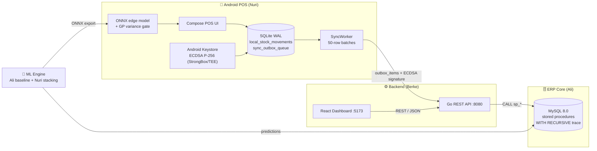
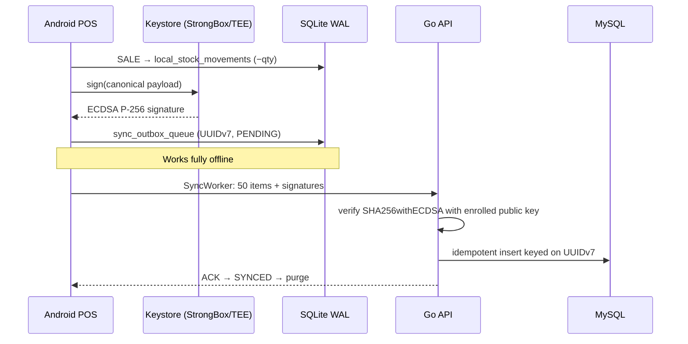

# 🥩 BAN Food Intelligence — AVATAR ERP

> Stock, cost and lot traceability platform for a food business, built for the **Delta-A AVATAR AI Competition**.
> MySQL handles ERP data, a Go REST API and React dashboard sit on top, an offline Kotlin Android POS handles sales, and an ML engine predicts production yield, unit cost (EKP) and butchery cut weights.


---

## 📌 Table of Contents
1. [Project Overview](#-project-overview)
2. [Quick Start (One-Click Run)](#-quick-start-one-click-run)
3. [System Architecture](#-system-architecture)
4. [Jury Assessment Notes](#-jury-assessment-notes)
5. [Repository Layout](#-repository-layout)
6. [Testing](#-testing)

---

## 🧭 Project Overview

| Layer | What it does |
|---|---|
| 🗄️ **ERP core (MySQL 8.0)** | Lots, stock movements, production orders, butchery, deliveries, customers. Uses stored procedures for cost calculation, butchery execution and recall, plus `WITH RECURSIVE` forward/backward lot tracing. |
| ⚙️ **Go REST API** | Calls the stored procedures, serves the dashboard and ingests ECDSA-signed outbox batches from the POS terminals. |
| 📊 **React Dashboard** | Production cost / EKP, butchery cost allocation (with the Task 2 discrepancy explained), recall war room, lot genealogy and the ML prediction-vs-actual tables. |
| 📱 **Android POS (Kotlin)** | Offline-first lot-tracked sales on SQLite WAL, ECDSA P-256 signed outbox, kiosk-mode recall lock that blocks sales from recalled lots. EN / DE / TR. |
| 🧠 **ML Engine (Python)** | Task 4A production yield & EKP, Task 4B butchery cut weights, and a retail edge model exported to ONNX for the POS. |

---

## 🚀 Quick Start (One-Click Run)

**Requirements:** Docker Desktop (Compose v2). Ports `3306`, `8080`, `5173` (and optionally `3000`) must be free.

```bash
git clone https://github.com/meowmet/ban-food-intelligence.git
cd ban-food-intelligence
docker compose up -d --build
```

| Service | URL | Notes |
|---|---|---|
| 📊 React Dashboard | http://localhost:5173 (also http://localhost:3000) | Main jury entry point |
| ⚙️ Go API | http://localhost:8080/health | Starts only after MySQL reports healthy |
| 🗄️ MySQL 8.0 | `localhost:3306` · `root` / `ban` · DB `food_intel` | `schema.sql` + `seed.sql` load automatically on first boot |

Startup order is handled by Compose: `mysql` (healthcheck) → `api-go` → `web-react`.

```bash
# Follow logs
docker compose logs -f api-go

# Try the scenario data directly in SQL
docker compose exec mysql mysql -uroot -pban food_intel -e "CALL sp_trace_forward('ET-2026-001')"

# Start over (wipes the MySQL volume so seed data reloads)
docker compose down -v
```

### Useful API endpoints
| Method | Path | Purpose |
|---|---|---|
| `GET` | `/health` | Liveness + DB ping |
| `GET` | `/production?order_no=URT-2026-045` | Task 1 production cost & EKP |
| `GET` | `/butchery` | Task 2 lamb butchery reconciliation |
| `GET` / `POST` | `/recall` | Task 3 recall impact (`ET-2026-001`) |
| `GET` | `/trace/{lot}?direction=forward\|backward` | Recursive lot genealogy |
| `GET` | `/yield` | Task 4 predictions vs actuals |
| `POST` | `/api/v1/sync` | ECDSA-signed POS outbox ingestion |
| `POST` | `/sync/register-key` | POS public key enrollment |

### 📱 Android POS (separate from Docker)
```bash
cd mobile-kotlin
./gradlew installDebug        # Windows: .\gradlew.bat installDebug
```
Open the app, pick a lot, enter a quantity and complete the sale. Try selling **`SUC-2026-045`** to see the recall lock.

---

## 🏗️ System Architecture



### 👥 Team roles

| Member | Owns | Key artifacts |
|---|---|---|
| **Ali** — data & baseline ML | MySQL schema, seed data, stored procedures (`sp_calculate_production_cost`, `sp_execute_butchery`, `sp_recall_by_lot`), recursive trace queries, data contract, CatBoost baseline + anomaly detection | `database-mysql/`, `ml-engine/ml_contract.py`, `train_model_ali.py`, `anomaly_ali.py` |
| **Nuri** — edge & advanced ML | Kotlin POS, SQLite outbox, Keystore ECDSA, kiosk recall lock, SyncWorker throttling, physics-informed models, Level-2 GP stacker, ONNX export | `mobile-kotlin/`, `train_model_nuri.py`, `nuri_consortium_pipeline.py`, `stacking_meta_learner.py` |
| **Berke** — backend & web | Go REST API, ECDSA verification on sync, React dashboard (cost tables, recall war room, genealogy, ML tables) | `api-go/`, `web-react/` |

Keeping the layers separate means each one has its own contract: the MySQL procedures are the only way to change ERP state, the Go API is the only thing that talks to MySQL, and the POS only ever sends signed outbox batches.

---

## ⚖️ Jury Assessment Notes

### 🧾 Task 1 — External production cost (`URT-2026-045`)
Total production cost **1,543.50 €** over **85 packages** gives **EKP = 18.16 € / package** (`SUC-2026-045`).

### 🐑 Task 2 — The lamb butchery discrepancy

The scenario says a **25 kg** lamb carcass was bought at **11.50 €/kg**, but the reported input cost is **351.00 €**.

$$25\ \text{kg} \times 11.50\ \text{€/kg} = 287.50\ \text{€} \quad\text{vs.}\quad 351.00\ \text{€ reported}$$

| Check | Value |
|---|---|
| Calculated purchase cost | **287.50 €** |
| Reported cost | **351.00 €** |
| Unexplained difference | **+63.50 €** (+22.1 %) |
| Effective price if 351.00 € is correct | 351.00 / 25 = **14.04 €/kg** |
| Mass balance | **22 kg** sellable cuts + **3 kg** bone/waste = **25 kg** ✅ |

**How we treat it:**
- The weights balance exactly, so this is **a cost problem, not a weight problem**.
- The 63.50 € gap would be explained by costs that are not in the per-kg price (transport, slaughter fee, veterinary inspection, cold storage) — or by a data-entry error. The scenario does not say which, so the system **flags it rather than silently picking one number**.
- The dashboard shows both numbers side by side, and runs cost allocation both ways:
  - **Quantity-based** — every kg carries the same cost (cost ÷ 22 kg sellable).
  - **Value-based (NRV)** — expensive cuts (leg, back) carry more of the cost than cheap ones (mince, shoulder), proportional to their sales value.
- The 3 kg waste carries no sales value, so its cost is absorbed by the sellable cuts.

### 🚨 Task 3 — Recall `ET-2026-001`
Forward trace: `ET-2026-001` → `URT-2026-045` → `SUC-2026-045` → **85 packages** delivered to **Market A: 30**, **Market B: 25**, **Market C: 30** (with contact details in the Recall War Room). The Android POS refuses to sell `SUC-2026-045` and locks the terminal.

### 🧠 Task 4 — ML accuracy: baseline vs. Nuri's stacking

**Baselines:** (1) the recipe's nominal yield, (2) the historical mean yield.

**Nuri's approach:**
1. **Physics-informed features / loss.** Mass balance is built in, so predicted outputs can never exceed inputs. Butchery cut shares are predicted on a **simplex** (they always add up to 100 %), so the predicted cuts always add up to the carcass weight.
2. **Level-1 models** trained with out-of-fold CV: physics-informed Ridge, Huber regression, LightGBM, and a hybrid blend. The retail edge pipeline (`nuri_consortium_pipeline.py`) adds a PINN-TabNet-style network alongside XGBoost, CatBoost and Extra Trees.
3. **Level-2 Gaussian Process stacker.** A GP sits on top of the Level-1 out-of-fold predictions. It returns a **mean and a variance** for every prediction, so the system knows when it is unsure.
4. **Adversarial hardening.** GP training includes FGSM-style perturbed samples, and the variance gate has a floor and a ceiling. Inputs that look out-of-distribution or spoofed push variance above the ceiling and **trigger the recall/lock flow instead of returning a confident number**.
5. **ONNX export** (`nuri_consortium_edge.onnx`) so the POS can run predictions offline.

**Held-out test results** (`ml-engine/artifacts/nuri/metrics.json`):

| Task 4A — production | Yield MAE (pp) | Yield R² | EKP MAE (€) |
|---|---|---|---|
| Baseline: recipe nominal | 2.32 | −0.57 | 0.320 |
| Baseline: historical mean | 1.85 | −0.00 | 0.259 |
| **Nuri: Huber** | **0.95** | **0.68** | **0.131** |
| Nuri: PINN-Ridge | 0.96 | 0.68 | 0.132 |
| Nuri: LightGBM | 1.06 | 0.62 | 0.149 |

| Task 4B — butchery (6 cuts) | Share MAE (pp) | Weight MAE (kg / cut) |
|---|---|---|
| Baseline: recipe nominal | 0.93 | 0.201 |
| Baseline: historical mean | 0.86 | 0.184 |
| **Nuri: Simplex Ridge** | **0.54** | **0.114** |

➡️ Compared with the best baseline, the error is roughly **halved** (Yield MAE −48 %, EKP MAE −49 %, cut weights −38 %), and mass balance holds to floating-point precision.

> [!NOTE]
> These numbers come from the competition's synthetic training data (1,500 production / 2,500 butchery records). Accuracy on real plant data would need to be re-checked.

### 🔄 SQLite ↔ MySQL sync strategy



- **Offline first.** Every sale is written to SQLite (WAL mode) first. The POS works with no network at all; the outbox drains when connectivity comes back (`SyncWorker`, WorkManager network constraint).
- **UUIDv7 keys.** Each record gets an RFC 9562 UUIDv7: time-ordered (good for B-tree indexes and replay order) and globally unique, so it doubles as an **idempotency key** — a retried batch cannot create duplicate sales.
- **ECDSA P-256 signatures.** Each record is signed with a private key that lives in the Android Keystore and **never leaves the hardware** (StrongBox when available, else TEE). The Go API checks `SHA256withECDSA` against the device's enrolled X.509 public key; anything tampered with is rejected. This replaced an earlier shared-secret HMAC, where one leaked secret would have compromised every terminal.
- **Fail-closed hardware policy.** On physical devices, if the key would only be software-backed, the app throws `FatalSecurityException` and locks instead of signing. (Android Studio emulators are allowed so the demo runs.)
- **Backlog handling.** Batches are capped at 50 rows (`LIMIT 50`) and run in a single lane with a 500 ms pause between them. A 20,000-record backlog after a long outage drains without exhausting memory, starving the SQLite WAL or freezing the UI.

---

## 📁 Repository Layout

```text
.
├── docker-compose.yml      # mysql + api-go + web-react
├── database-mysql/         # Ali: schema, seed, stored procedures, trace queries, tests
├── api-go/                 # Berke: Go REST API (+ Dockerfile)
├── web-react/              # Berke: React + Vite dashboard (+ Dockerfile)
├── mobile-kotlin/          # Nuri: Android POS (Compose, SQLite WAL, Keystore, kiosk lock)
├── ml-engine/              # Ali + Nuri: generators, training, stacking, ONNX, metrics
├── security-pentest/       # Red-team notes and test scripts
└── SECURITY.md
```

---

## 🧪 Testing

```bash
# Go: ECDSA sync verification
cd api-go && go test ./...

# MySQL procedures & traceability (needs the mysql container running)
pip install -r ml-engine/requirements.txt
pytest database-mysql

# ML retraining (rewrites ml-engine/artifacts/*/metrics.json)
python ml-engine/train_model_ali.py
python ml-engine/train_model_nuri.py

# Android
cd mobile-kotlin && ./gradlew assembleDebug
```

---

<p align="center">Built for the <b>Delta-A AVATAR AI Competition 2026</b> · Team BAN — Ali · Nuri · Berke</p>
