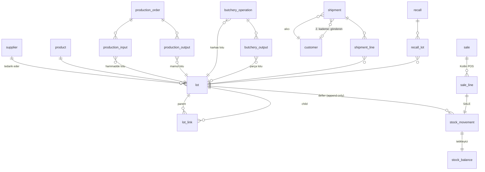

# Merkezi veritabanı (MySQL 8) — veri modeli, izlenebilirlik, geri çağırma

Sahibi: **Ali**. Tüketenler: Go API (Berke, `api-go/`), Kotlin/SQLite senkronizasyonu (Nuri, `mobile-kotlin/`).

## Kurulum

```bash
docker compose up -d mysql                     # schema.sql + seed.sql otomatik yüklenir
# veya kendi MySQL 8'inizle:
MYSQL="mysql -uroot -p" ./database-mysql/load.sh

pip install -r ml-engine/requirements.txt
MYSQL_HOST=127.0.0.1 MYSQL_PASSWORD=ban pytest database-mysql/tests -q     # 26 entegrasyon testi
```

| Dosya | İçerik |
|---|---|
| `schema.sql` | (1) tablolar, FK'ler, CHECK kısıtları (2) EKP/marj, stok, mutabakat, KI sapma görünümleri (3) tetikleyiciler + saklı yordamlar |
| `seed.sql` | (1) şartnamedeki zorunlu senaryo (ET-2026-001 → URT-2026-045 → SUC-2026-045 → Market A/B/C) (2) çoktan-çoğa lotlar, 2. kademe dağıtım, kuzu parçalama, POS satışı (3) model tahmini + gerçek + sapma |
| `queries/*.sql` | Tek ifadelik WITH RECURSIVE sorgular (`?` parametreli, Go'dan doğrudan) |
| `demo/recall_demo.sql` | Videodaki geri çağırma akışı, adım adım |
| `tests/` | pytest + gerçek MySQL 8 entegrasyon testleri |

## Veri modeli



Temel kararlar:

* **Tek soyağacı tablosu (`lot_link`)**: üretim, parçalama ve yeniden işleme aynı kenar tablosunda,
  miktarlarıyla (`qty_consumed`, `qty_produced`). Bir emirde birden çok hammadde lotu, bir lottan birden
  çok mamul lotu desteklenir. İleri/geri izleme tek bir `WITH RECURSIVE` ile her derinlikte çalışır;
  yol (path) üzerinden döngü koruması ve derinlik sınırı vardır.
* **Stok yalnız defterden**: `stock_movement` append-only'dir (UPDATE/DELETE tetikleyiciyle reddedilir;
  düzeltme = ters hareket). `stock_balance` tetikleyiciyle tutulur, `CHECK (qty >= 0)`; çıkışlarda bakiye
  satırı `FOR UPDATE` ile kilitlenir, eşzamanlı iki POS satışı stoku eksiye düşüremez.
  `v_stock_ledger_check` önbelleği defterle karşılaştırır (testte sıfır fark).
* **Para**: `DECIMAL` (birim maliyet 4, tutar 2 hane). EKP lotta 4 haneli saklanır (18,1588), gösterimde 18,16.
* **Geri çağırma KI'ye değil kayda dayanır**: `sp_recall_initiate` ileri izlemedeki tüm lotları
  `RECALLED` yapar; SALE / SHIPMENT / üretim tüketimi tetikleyicide `LOT_BLOCKED` ile reddedilir.
  İade (`RETURN`) ve imha (`WASTE`) serbesttir. Durum değişiklikleri `audit_log`'a (append-only) yazılır.
* **2. kademe dağıtım** yalnız kaydedilmişse gösterilir: `shipment.from_customer_id` dolu sevkler
  (ör. Market C → Örnek Lokanta) özyinelemeli olarak `tier = 2` diye listelenir.

## Görev 1 — EKP (şartname rakamlarıyla)

```sql
SELECT * FROM v_production_cost_breakdown WHERE order_no = 'URT-2026-045';
-- ET-2026-001  100 kg × 9,70  = 970,00
-- BAH-2026-001   2 kg × 24,00 =  48,00
-- BAG-2026-001   5 kg × 11,60 =  58,00
-- Fason hizmet  85 × 5,50     = 467,50
SELECT total_cost, actual_qty, ekp_display, vkp, gross_profit_total, margin_pct
  FROM v_production_cost WHERE order_no = 'URT-2026-045';
-- 1543.50 | 85 | 18.16 | 24.90 | 573.00 | 27.07
```

`sp_production_complete` gerçek teslim miktarıyla EKP'yi tek transaction'da hesaplar, mamul lotunu açar,
fasondaki tüketimi düşer ve `lot_link` kenarlarını yazar. URT-2026-046 (83 paket, −2 miktar farkı) aynı
maliyetin daha az pakete bölündüğünü gösterir (EKP 18,64 €). VKP (24,90 €) şartnamede verilmediği için örnektir.

## Görev 2 — parçalama mutabakat kapısı

`v_butchery_reconciliation` ağırlık dengesi, beyan edilen maliyet ve dağıtım toplamını kontrol eder:

| İşlem | Girdi | Çıktı | Maliyet | Beyan | Sonuç |
|---|---|---|---|---|---|
| PRC-2026-000 (şartname görseli) | 25 kg | 22 kg, fire yok | 25 × 11,50 = 287,50 € | 351,00 € (+63,50 belgesiz) | **REJECTED** |
| PRC-2026-001 (düzeltilmiş) | 25 kg | 22 kg + 3 kg kemik/fire | 287,50 € | — | **POSTED** |

Değer ağırlıklı dağıtım: `pay_i = 287,50 × (kg_i × VKP_i) / Σ(kg × VKP)`, Σ = 430,00; kuruş artığı
en büyük kesirli kalana verilir (largest remainder), toplam tam 287,50 €. Fire maliyet taşımaz.
(Dağıtımın API tarafı Berke'de; bu görünüm onun sonucunu da denetler.)

## Görev 3 — izlenebilirlik ve geri çağırma

```sql
CALL sp_trace_forward('ET-2026-001');    -- lotlar, depodaki stok, alıcılar (1. ve 2. kademe), POS satışları
CALL sp_trace_backward('SUC-2026-045');  -- hammadde lotları + tedarikçi + üretim emri + fason
CALL sp_recall_initiate('GC-2026-001', 'ET-2026-001', 'Kalite sorunu', 'kalite.sorumlusu');
CALL sp_recall_report('GC-2026-001');    -- market bazlı miktar, iade, iletişim + bloke stok
```

`queries/affected_markets.sql` sonucu (ET-2026-001):

| tier | customer | received_via | lots | qty |
|---|---|---|---|---|
| 1 | Market A | | SUC-2026-045 | 30 |
| 1 | Market B | | SUC-2026-045 | 25 |
| 1 | Market C | | SUC-2026-045 | 30 |
| 2 | Örnek Lokanta | Market C | SUC-2026-045 | 10 |

Negatif kontrol: BAH-2026-001 (baharat) her iki sucuk lotunda kullanıldığı için onun ileri izlemesi
Örnek Toptancı'yı da bulur; ET-2026-001'in izlemesi bulmaz. Geri çağırmada SUC-2026-046 `ACTIVE` kalır.

## API / senkronizasyon için hata kodları

Tetikleyiciler `SQLSTATE 45000` ve aşağıdaki mesaj önekleriyle döner; Go tarafında HTTP koduna eşlenebilir:

| Önek | Anlam | Öneri |
|---|---|---|
| `LOT_BLOCKED` | Geri çağrılan / bloke lot satış, sevk veya üretimde kullanılamaz | 409 → Kotlin kırmızı kilit ekranı |
| `INSUFFICIENT_STOCK` | Hareket lot bakiyesini eksiye düşürür | 409 |
| `MOVEMENT_SIGN` | Giriş türü negatif / çıkış türü pozitif | 400 |
| `IMMUTABLE` | Defter / audit_log değiştirilemez | 403 |
| `ORDER_STATE` | Üretim emri durum sırası ihlali | 409 |
| `LOT_NOT_FOUND` | İzleme için lot yok | 404 |

POS satışı için `sale.sale_uuid` (UUIDv7) benzersizdir; aynı outbox paketi ikinci kez gelirse
`sync_inbox.event_uuid` birincil anahtarı tekrar işlemeyi engeller. `sale_line` eklenince tetikleyici
SALE stok hareketini yazar ve satırın `stock_movement_id`'sine bağlar.

## Go modelleriyle eşleme (Berke için)

`api-go/models/lot.go` içindeki alanlar şu kolonlardan doldurulabilir:

| Go alanı | MySQL |
|---|---|
| `Lot.LotNumber`, `Quantity`, `Unit`, `ExpiryDate` | `lot.lot_no`, `lot.initial_qty`, `lot.uom_code`, `lot.expiry_date` |
| `Lot.CurrentQuantity` | `SUM(stock_balance.qty)` (veya `v_stock_by_lot`) |
| `Lot.Status` | `lot.status` (`ACTIVE`, `BLOCKED`, `RECALLED`, `DEPLETED`) — Go'daki `QUARANTINE/RELEASED/...` listesiyle eşleme kararı Berke'de |
| `LotTraceNode.Depth`, `TracePath`, `QuantityConsumed` | `queries/trace_forward.sql` / `trace_backward.sql` kolonları `depth`, `path`, `qty_consumed` |
