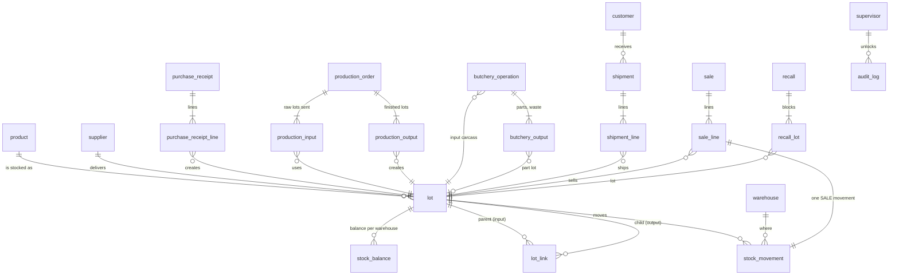

# Architecture

## Components

| Component | Technology | Responsibility |
|---|---|---|
| Central database | MySQL 8 | Single source of truth: lots, lot relations, stock ledger, costs, sales, recalls. Business rules live in triggers and stored procedures so every client gets them. |
| API | Go (`net/http`, `database/sql`) | REST endpoints, sync ingestion, supervisor PIN check, AI summary. Thin: it calls procedures/views and maps MySQL errors to HTTP codes. |
| Dashboard | React + Vite | Reports and recall for office staff. Reads only through the API. |
| POS | Kotlin, Jetpack Compose, SQLite | Selling in the shop, offline first. Local sales + signed outbox; lots and recalls cached for offline use. |
| ML | Python (scikit-learn, CatBoost) | Training and evaluation on synthetic history; results are written into the seed (`ml_prediction`, `ml_model_metric`). |

## Data model



### Lots and their many-to-many relations

Every physical batch is a row in `lot` (raw material, finished good, carcass, part, rework).
How lots turn into other lots is stored in **one edge table**:

```
lot_link(parent_lot_id, child_lot_id, link_type, qty_consumed, qty_produced, ref_type, ref_id)
```

- One production order can consume several raw lots (meat, spice, casing → 3 edges into SUC-2026-045).
- One raw lot can feed several finished lots (BAH-2026-001 → SUC-2026-045 and SUC-2026-046).
- A butchery operation links the carcass to every part lot (KUZU-2026-001 → 5 part lots).
- Rework links an existing lot to the new lot it becomes.

`qty_consumed` is in the parent's unit and `qty_produced` in the child's unit, so each edge says
exactly how much went in and came out. Because all three processes use the same table, one
recursive query (`WITH RECURSIVE`, cycle-safe, depth-limited) answers forward and backward trace
for all of them (`sp_trace_forward`, `sp_trace_backward`). Recall (`sp_recall_initiate`) marks the
root and every reachable child RECALLED in one transaction and records them in `recall_lot`.

### Stock

`stock_movement` is an **append-only ledger** (UPDATE and DELETE are rejected by triggers; a
mistake is fixed with a correcting movement). Each movement has a signed quantity and a type:
purchase, transfer in/out, production consume/receipt, butchery consume/output, shipment, sale,
return, rework consume/output, waste, adjustment.

A `BEFORE INSERT` trigger enforces the rules for every client:

- the sign matches the type (in > 0, out < 0);
- a recalled or blocked lot cannot be sold, shipped or consumed (returns and quarantine moves are allowed);
- a lot past its expiry date cannot be sold or shipped (`LOT_EXPIRED`); the date that counts is the
  movement's own time, so an offline sale made before the expiry is still accepted when it syncs later;
- the balance may never go negative (the balance row is locked `FOR UPDATE`, so concurrent sales cannot both pass;
  `TestIntegrationConcurrentSalesNeverOversell` sends 10 simultaneous sales for 3 packs: exactly 3 are booked).
  A `CHECK (qty >= 0)` on `stock_balance` is the second guard.

`stock_balance` is a cache maintained by the `AFTER INSERT` trigger; `v_stock_ledger_check`
recomputes it from the ledger to prove they agree. Shipment lines and POS sale lines create their
stock movement through triggers, so a sale line cannot exist without its movement
(`sale_line.stock_movement_id`).

### Costs

- **EKP:** `v_production_cost` = (Σ consumed raw quantity × lot cost at shipment + actual packs ×
  service price) / actual packs. Raw cost is snapshotted when material is sent.
- **Butchery:** `total_cost = input kg × purchase price + documented extra cost`. The declared amount
  is stored separately; a mismatch is a finding, never silently used. The cost is split over the
  parts by quantity (kg) or value (kg × VKP) with the largest-remainder rule, so the cents always add
  up to the total. Waste gets no cost.

## SQLite ↔ MySQL sync

The shop must keep selling when the network is down, but stock and recall decisions must stay
consistent. The approach:

1. **MySQL is the source of truth.** The phone never edits central stock directly; it sends sale
   events. Lots, prices and recalls flow down from the API (`GET /lots`, `GET /recall`).
2. **Local write first.** A sale is written to SQLite (WAL mode) in one transaction: the local
   movement and an outbox record. Each record gets a **UUIDv7** (time-ordered, unique per device)
   and an **ECDSA P-256 signature** made with a key in the Android Keystore.
3. **Background sending.** A WorkManager job (network required, exponential backoff) sends
   batches of up to 50 records to `POST /sync`. The batch envelope is signed as well.
4. **Idempotent apply.** For each record the API verifies the signature, then in one MySQL
   transaction inserts `sync_inbox(event_uuid PRIMARY KEY)`, `sale` (with `sale_uuid UNIQUE`) and
   `sale_line`; the trigger writes the SALE stock movement with the original sale time. If the
   UUID is already in `sync_inbox`, the record is a replay: it is acknowledged and nothing is
   inserted. Sending the same batch twice therefore never books a sale twice.
5. **Acknowledge only what was applied.** The response lists `acknowledged_ids`; only those are
   marked SYNCED on the phone. Records MySQL refuses come back in `rejected` with a code:
   - permanent (`INSUFFICIENT_STOCK`, `LOT_BLOCKED`, `LOT_EXPIRED`, `INVALID_INPUT`, `CONFLICT`): the phone marks
     them REJECTED, shows the reason on the Sync tab and stops retrying;
   - temporary (`DB_ERROR`, network): they stay queued and are retried.
6. **Conflicts.** The phone may sell from a cached stock figure while offline. MySQL decides: the
   central ledger cannot go negative and a recalled lot cannot be sold, so a conflicting sale is
   rejected with its reason instead of corrupting stock. To reduce conflicts the phone subtracts
   its own unacknowledged sales from the cached stock and blocks quantities above it.
7. **Offline recall enforcement.** The last lot list and active recalls are cached on the phone.
   Recalled lots are blocked from that cache even without network. When a new recall reaches lots
   in the shop, sales pause until a supervisor confirms the shelf was cleared (PIN checked online
   with bcrypt and audit, or offline with a PBKDF2 hash).

```mermaid
sequenceDiagram
  participant POS as Android POS (SQLite)
  participant API as Go API
  participant DB as MySQL
  POS->>POS: sale -> local movement + signed outbox record (UUIDv7)
  Note over POS: works offline
  POS->>API: POST /sync (batch, ECDSA signatures)
  API->>API: verify signatures
  API->>DB: BEGIN; INSERT sync_inbox (UUIDv7 PK)
  alt new UUID
    API->>DB: INSERT sale, sale_line -> trigger: SALE movement (checks stock, recall)
  else replay
    API->>DB: nothing to insert
  end
  API->>DB: COMMIT (or ROLLBACK on rule violation)
  API-->>POS: acknowledged_ids + rejected[{id, code, message}]
  POS->>POS: SYNCED / REJECTED (+ reason) / keep for retry
```

## Security notes

- No secrets in the repository: the vision key is an API environment variable (`NVIDIA_API_KEY`,
  from a gitignored `.env` for compose) and never reaches the dashboard or the phone; the offline
  PIN hash comes from the gitignored `mobile-kotlin/local.properties`; MySQL stores only a bcrypt
  hash of the supervisor PIN.
- The phone's back-office actions (receipt from an invoice, stock count) use the same supervisor
  session as the dashboard (`POST /auth/session`, token in memory only). The POS sync carries only
  sales: a received or counted quantity is never sent through the outbox, because the sync record
  (lot + quantity) would be booked as a till sale.
- Supervisor PIN: 5 wrong attempts per device → 5-minute lockout (server and phone); every attempt
  is written to `audit_log`.
- `audit_log` and `stock_movement` are append-only.
- Debug builds allow cleartext HTTP to a LAN IP for the demo; release builds only to the local
  hosts (127.0.0.1, localhost, emulator host).
- Back-office writes need a supervisor session (PIN → 30-minute signed token); reads stay open for
  the dashboard and the POS.
- Known limits for a production rollout: one shared supervisor PIN instead of per-user accounts,
  plain HTTP on a local network, and device keys enrolled on first use. Details and the hardening
  plan: [SECURITY.md](SECURITY.md).
